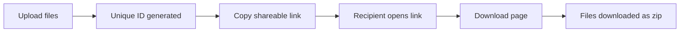

# File Sharing App

A file sharing web application built with **Django** and **Django REST Framework**. Upload files in any common format, get a shareable link, and let anyone download the files from that link as a single zip.

## How it works

1. Click **Upload** and choose your files. Supported formats include PDF, Word documents, and images (JPG, PNG).
2. After uploading, click **Copy Link URL**. An alert box shows the generated URL.
3. Open the copied URL in a browser (for example Chrome) to reach the **download page**.
4. Click **Download Files**. All the files are downloaded together as a **zipped folder**, which you'll find in your computer's Downloads folder.
5. Each upload batch gets a **unique ID**, which is what makes the link shareable.



## Features

- Upload multiple files in different formats (PDF, Word, JPG, PNG)
- Unique link generated for each upload
- One-click "Copy Link URL" button
- Download page that bundles all files into a zip
- REST API built with Django REST Framework 
- Simple HTML, CSS, and JavaScript front end

## Technologies used

- **Python**
- **Django**
- **Django REST Framework**
- **HTML**
- **CSS**
- **JavaScript**

## How it works
This app is used to upload files in any format, be it pdf, word or image -jpg or png files and after uploading we can download the files using the URL provided the UI shows Upload button
On clicking Upload files button we have an option of copy link URL button
On clicking CopyLink URL button we get a alert box with the url
the copied URL can be opened in the chrome browser and we get the download page, on clicking download files button we get all the files downloaded- check in downloads of your local computer, we get all the files woth the unique id being downloaded in the zipped folder


## Project structure

```
django-restframework-fileSharing/
├── fileupload/        # Django app: models, views, serializers, templates 
└── README.md
```

>  Replace the comment with the actual files inside `fileupload/`.

## Getting started

### Prerequisites

- Python 3.8 or higher
- pip

### Installation

```bash
git clone https://github.com/SyedaNaziaGit/django-restframework-fileSharing.git
cd django-restframework-fileSharing
python -m venv venv
source venv/bin/activate        # Windows: venv\Scripts\activate
pip install django djangorestframework
```

>  If the app stores images with an `ImageField`, also run `pip install pillow`.

### Run the app

The repo contains the `fileupload` app, so you need a Django project around it.

**1. Create a Django project**

```bash
django-admin startproject projectname
```

**2. Add the app to the project**

Copy the `fileupload` folder into the project folder (next to `manage.py`). If you were creating a new app from scratch, you would use:

```bash
python manage.py startapp appname
```

**3. Register the apps in `settings.py`**

> Note: include all your apps in the `INSTALLED_APPS` list in `settings.py`.

```python
INSTALLED_APPS = [
    # ...
    'rest_framework',
    'fileupload',
]
```

**4. Configure file storage and URLs** 

```python
# settings.py
MEDIA_URL = '/media/'
MEDIA_ROOT = BASE_DIR / 'media'
```

Include the app's URLs in the project's `urls.py`.

**5. Set up the database and run the server**

```bash
python manage.py makemigrations
python manage.py migrate
python manage.py runserver
```

You will get the development server at `http://127.0.0.1:8000/`.

Note:
Include all your apps and installed apps to the insallted apps list in settings.py

## What I learned

- Handling multi-file uploads in Django
- Building REST endpoints with Django REST Framework
- Generating unique IDs for shareable links
- Creating zip downloads on the server
- Connecting a JavaScript front end to a Django backend

## Author

**Syeda Nazia** · [GitHub](https://github.com/SyedaNaziaGit) · [LinkedIn](https://www.linkedin.com/in/syeda-nazia) · [Portfolio](https://syedanaziagit.github.io/nazia_portfolio_website/)
---
